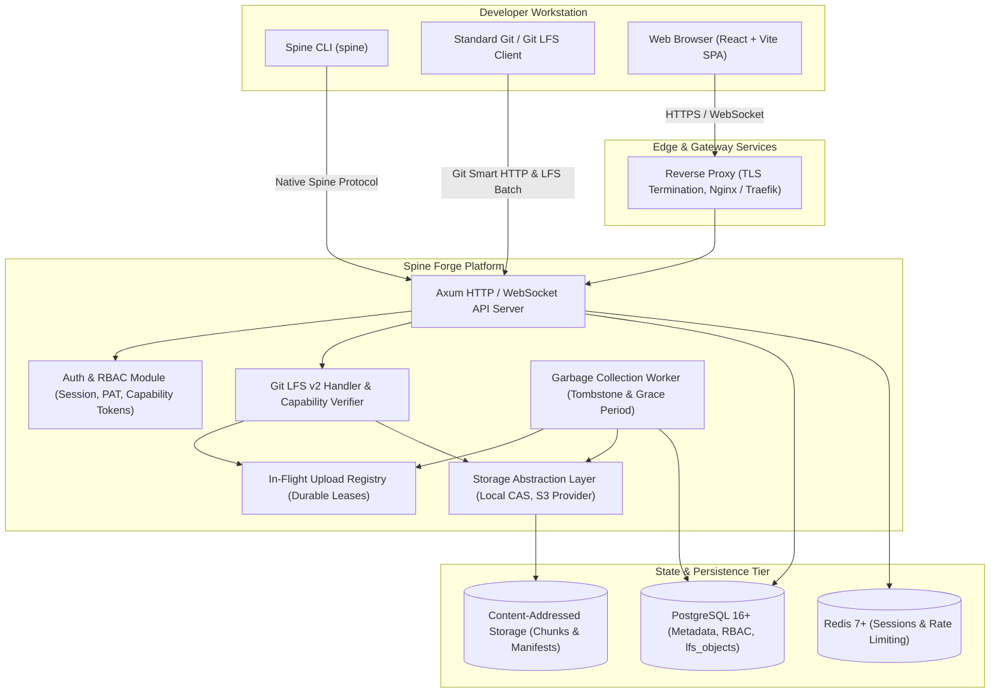
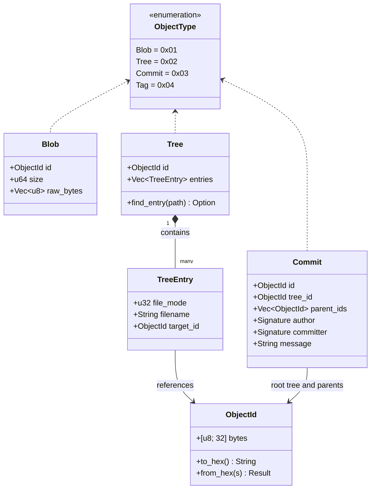
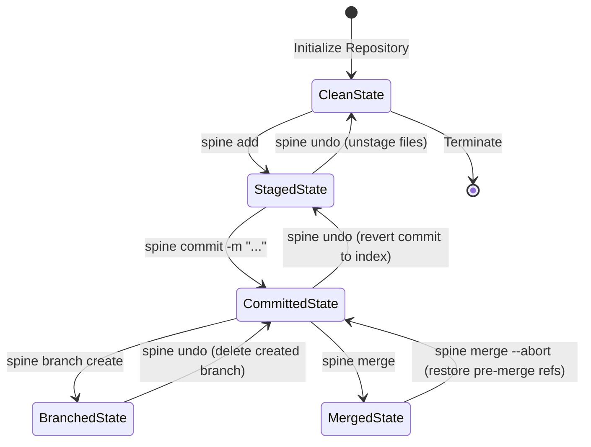
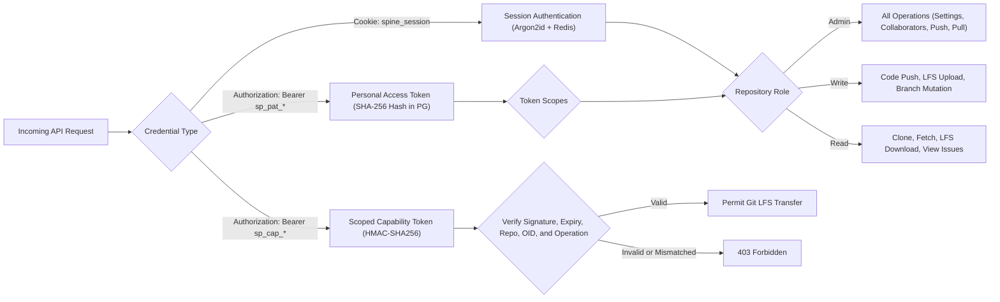
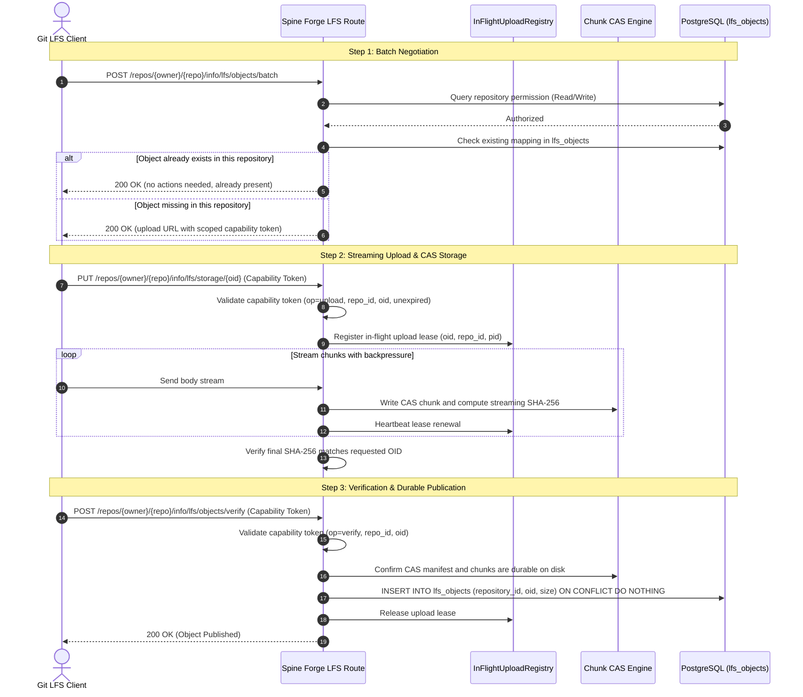
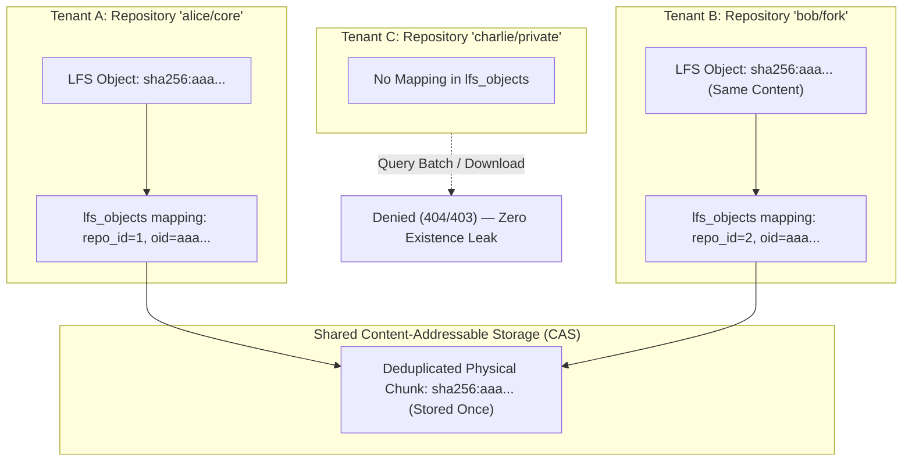
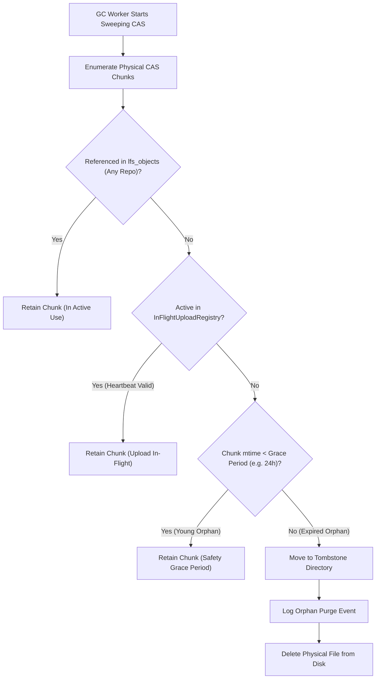
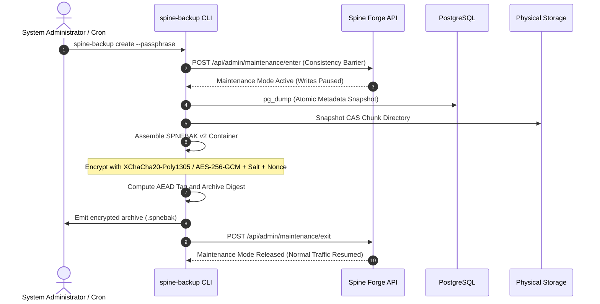

# SPINE ARCHITECTURAL SPECIFICATION

Spine is an enterprise-grade, high-performance distributed version control ecosystem and modern developer collaboration platform engineered entirely in safe systems Rust.

This document describes the end-to-end architectural design, cryptographic storage engines, multi-tenant isolation boundaries, Git LFS data-flow pipelines, and disaster recovery guarantees of Spine.

---

## 1. System Ecosystem & Multi-Tier Topology

Spine separates concerns cleanly between the decentralized client-side version control engine (**Spine VCS**) and the centralized enterprise collaboration platform (**Spine Forge**).



---

## 2. Spine VCS Engine (`git-alternative/`)

Spine VCS operates as an independent, fully decentralized version-control engine with zero dependencies on C libraries (`libgit2`) or external Git subprocesses.

### 2.1 Content-Addressed Merkle DAG

Every artifact in Spine is stored as an immutable, content-addressed object identified by its cryptographic digest.



#### Cryptographic Domain Separation
To prevent cross-type preimage or substitution attacks (e.g., crafting a blob that can parse as a valid commit or tree), Spine prepends an explicit domain separator before computing BLAKE3 digests:

$$\text{Digest} = \text{BLAKE3}\left(\text{"SPINE\0"} \mathbin{\Vert} \text{type\_byte} \mathbin{\Vert} \text{"\0"} \mathbin{\Vert} \text{payload\_len}_{\text{u64\_le}} \mathbin{\Vert} \text{"\0"} \mathbin{\Vert} \text{payload}\right)$$

### 2.2 On-Disk Repository Layout (`.spine/`)

```
.spine/
├── spine.toml             # Repository format version and configuration
├── HEAD                   # Active symbolic or direct reference pointer
├── index                  # Binary staging manifest with mtime/size caches
├── journal/               # Append-only transactional undo/redo log
├── objects/
│   ├── info/              # Multi-pack index (MIDX) descriptors
│   ├── [0-9a-f]{2}/       # Loose Zstandard-compressed objects
│   │   └── [0-9a-f]{62}   # Payload: Header (magic, type, size) + Zstd stream
│   └── pack/              # Compressed multi-object packfiles and indices (.spk, .spx)
└── refs/
    ├── heads/             # Local branch heads (refs/heads/main)
    └── tags/              # Cryptographic release tags
```

### 2.3 Transaction Journal & Undo/Redo Engine

Spine implements an append-only transaction journal (`.spine/journal/`) that tracks every state-modifying operation. Every command creates a reversible transaction record with forward and inverse actions, providing fearless, instant undo/redo capabilities.



---

## 3. Spine Forge Platform (`github-alternative/`)

Spine Forge is the multi-tenant collaboration platform providing repository management, pull requests, issue tracking, and high-performance storage nodes.

### 3.1 Authentication & Authorization Matrix

Spine Forge supports three distinct authentication and authorization primitives:



---

## 4. Git LFS & Content-Addressable Storage (CAS) Pipeline

Git LFS in Spine uses Content-Addressable Storage (CAS) for high performance and global storage deduplication, while enforcing strict multi-tenant authorization.

### 4.1 LFS Data-Flow Architecture



### 4.2 Multi-Tenant Logical Isolation vs Shared Deduplication



---

## 5. Cross-Process & Multi-Worker GC Safety

To prevent Garbage Collection (GC) workers from pruning CAS chunks during long-running concurrent uploads, Spine enforces a multi-tier protection mechanism.



### In-Flight Upload Lease Lifecycle
- **Registration:** Created upon upload initiation (`.spine_uploads/<upload_id>.lease`).
- **Heartbeat:** Periodically updated while streaming bytes.
- **Expiration:** If an upload process crashes, leases expire after 15 minutes.
- **Cleanup:** GC treats expired leases without running PIDs as collectable orphans.

---

## 6. Disaster Recovery & Backup Architecture (SPNEBAK v2)

Spine Forge includes an authenticated backup and restore engine designed for enterprise recovery time objectives (RTO).



### SPNEBAK v2 File Container Format

```
+-------------------------------------------------------------------------+
| Magic Bytes: "SPNEBAK\0" (8 bytes)                                     |
+-------------------------------------------------------------------------+
| Format Version: 0x0002 (u16 big-endian)                                 |
+-------------------------------------------------------------------------+
| Cipher Suite: 0x01 (XChaCha20-Poly1305) or 0x02 (AES-256-GCM) (u8)     |
+-------------------------------------------------------------------------+
| Key Derivation Salt: Argon2id Salt (32 bytes)                           |
+-------------------------------------------------------------------------+
| Initialization Vector / Nonce (12 or 24 bytes)                          |
+-------------------------------------------------------------------------+
| Authenticated Associated Data (AAD): Manifest Header JSON               |
+-------------------------------------------------------------------------+
| Encrypted Payload: Compressed Metadata SQL + CAS Blobs                  |
+-------------------------------------------------------------------------+
| Poly1305 / GCM Authentication Tag (16 bytes)                            |
+-------------------------------------------------------------------------+
```

---

## 7. Migration & Upgrade Operability

Database schema evolutions are managed using versioned, forward-compatible SQL migrations with zero data loss.

### Legacy LFS Preflight & Remediation (`lfs_preflight`)
For existing installations upgrading to multi-tenant LFS isolation (Migration `0016_multitenant_lfs_mapping`):
- **Preflight Inspection:** The `lfs_preflight` utility audits existing `artifact_manifests` and `lfs_objects` rows.
- **Fail-Closed Validation:** Prevents migration if unmapped or ambiguous legacy rows exist without explicit operator assignment.
- **Operator Remediation:** Allows operators to supply an audited CSV mapping file to safely associate legacy manifests with their rightful owner repositories.

---

## 8. Summary of Security & Operational Invariants

1. **Deterministic Hashing:** BLAKE3 with domain separation prevents cross-type collisions.
2. **Path Confinement:** Working trees and storage roots strictly reject path traversal and symlink escapes.
3. **Multi-Tenant Logical Isolation:** Deduplicated CAS blobs are never accessible without an explicit repository mapping.
4. **Lease-Protected GC:** Active uploads cannot be garbage-collected, even across multiple worker processes.
5. **Crash Resilience:** Two-phase atomic tempfile renames prevent partially written objects or manifests upon system failure.
