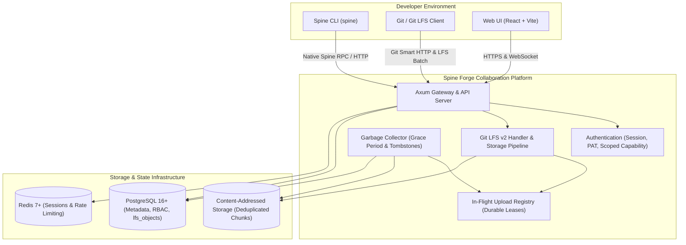

# SPINE

<div align="center">

[](https://github.com/Neutron-0/Spine/actions/workflows/ci.yml)
[](file:///d:/Vault/Spine/LICENSE)
[](https://www.rust-lang.org/)
[]()

**A high-performance, Rust-native distributed version-control ecosystem and modern developer collaboration platform.**

[Architecture](file:///d:/Vault/Spine/ARCHITECTURE.md) • [Contributing](file:///d:/Vault/Spine/CONTRIBUTING.md) • [Security Policy](file:///d:/Vault/Spine/SECURITY.md) • [Code of Conduct](file:///d:/Vault/Spine/CODE_OF_CONDUCT.md) • [License](file:///d:/Vault/Spine/LICENSE)

</div>

---

## Overview

**Spine** delivers an end-to-end, memory-safe alternative to legacy version control systems and centralized code-hosting platforms. Written from the ground up in safe systems Rust, Spine eliminates external dependencies on C libraries (`libgit2`) and Git subprocess wrappers.

Spine comprises two tightly integrated systems:

1. **Spine VCS (`git-alternative/`):** An independent, decentralized version-control engine with an intuitive command-line interface (`spine`), high-throughput Zstandard object compression, BLAKE3 domain-separated cryptographic hashing, and a transactional journal supporting instant undo and redo.
2. **Spine Forge (`github-alternative/`):** An enterprise-grade developer collaboration platform powered by Tokio, Axum, PostgreSQL, and React. It features multi-tenant Git LFS with global Content-Addressable Storage (CAS) deduplication, cross-process durable GC upload leases, scoped capability tokens, and authenticated disaster recovery (`SPNEBAK` v2).

---

## System Architecture



For a comprehensive technical breakdown, see the full [System Architecture Specification](file:///d:/Vault/Spine/ARCHITECTURE.md).

---

## Feature Comparison

| Capability | Legacy Git / External Forges | Spine Ecosystem |
|:---|:---|:---|
| **Core Language** | C / Shell / C++ / Python wrappers | **100% Safe Systems Rust** |
| **Object Hashing** | SHA-1 (legacy) / SHA-256 | **BLAKE3 (256-bit)** with Domain Separation |
| **Working Tree Index** | Binary fixed `index` | **Memory-mapped $O(1)$ stat-cache manifest** |
| **Undo / Redo** | `git reflog` + manual reset surgery | **Transactional append-only journal (`spine undo`/`redo`)** |
| **Large File Storage** | Monolithic pointers / external LFS servers | **Native CAS chunking, global deduplication, scoped tokens** |
| **Upload / GC Concurrency** | Prone to orphan purge races | **Cross-process durable in-flight upload leases** |
| **Disaster Recovery** | Manual database dumps + file snapshots | **SPNEBAK v2 authenticated encryption (AEAD)** |

---

## Workspace Layout

```
spine/
├── ARCHITECTURE.md            # Deep system architecture & Mermaid diagrams
├── CONTRIBUTING.md            # Developer guides, testing requirements, CI rules
├── SECURITY.md                # Security disclosure, threat model, boundaries
├── LICENSE                    # Dual MIT / Apache-2.0 license notice
├── docs/                      # Technical specifications, ADRs, and guides
├── git-alternative/           # Spine VCS engine, libraries, and CLI
│   ├── apps/
│   │   └── spine-cli/         # Native `spine` command-line tool
│   └── crates/
│       ├── spine-core/        # Object IDs, types, signatures, domain separation
│       ├── spine-format/      # Binary serialization and encoding protocols
│       ├── spine-object-store/# Content-addressed storage, Zstd compression
│       ├── spine-index/       # Staging manifest and fast stat-cache
│       ├── spine-worktree/    # Filesystem scanner, ignore rules, status
│       ├── spine-history/     # Merkle DAG traversal and topological log
│       ├── spine-diff/        # Myers line diff and change calculation
│       ├── spine-config/      # User and repository configuration
│       ├── spine-integrity/   # fsck integrity validator
│       ├── spine-merge/       # 3-way tree and text merge engine
│       └── spine-journal/     # Transactional undo/redo journal
├── github-alternative/        # Spine Forge collaboration platform
│   ├── backend/               # Rust Axum API services, LFS handler, CAS engine
│   └── frontend/              # Modern React + TypeScript + Vite web client
└── scripts/                   # CI scope detector, secret scanner, LFS preflight
```

---

## Quickstart: Spine VCS CLI

### 1. Build from Source
```powershell
cd git-alternative
cargo build --release
# Optional: Add to PATH
$env:PATH += ";$PWD\target\release"
```

### 2. Daily Workflow
```powershell
# Initialize a new repository (.spine/)
spine init

# Configure user identity
spine config set user.name "Alice Engineer"
spine config set user.email "alice@example.com"

# Stage files and inspect status
spine add .
spine status

# Commit changes
spine commit -m "feat: initial commit"

# Review history and inspect commits
spine log
spine show HEAD

# Create and switch branches
spine branch create feature-stream
spine switch feature-stream

# Three-way merge
spine switch main
spine merge feature-stream

# Fearless undo & redo
spine undo              # Undo previous operation
spine redo              # Redo undone operation
spine undo --list       # View transaction journal history

# Validate cryptographic integrity
spine fsck
```

---

## Quickstart: Spine Forge Platform

### 1. Local Development Cluster (Docker Compose)
Launch PostgreSQL 16, Redis 7, and Spine Forge dependencies:

```powershell
docker compose -f docker-compose.dev.yml up -d
```

### 2. Run the Backend API Server
```powershell
cd github-alternative/backend
cargo run --bin spine-forge-server
```

### 3. Run the Frontend Web UI
```powershell
cd github-alternative/frontend
npm install
npm run dev
```

### 4. Production Deployment
For production setups with multi-tenant storage nodes, SSL termination, and background GC workers:
```powershell
docker compose -f docker-compose.prod.yml up -d
```

---

## Verification & Quality Assurance

Spine adheres to strict local-first verification before pushing code to remote repositories:

```powershell
# Format checks across both workspaces
cargo fmt --manifest-path git-alternative/Cargo.toml --all -- --check
cargo fmt --manifest-path github-alternative/backend/Cargo.toml --all -- --check

# Clippy lints (zero warnings)
cargo clippy --manifest-path git-alternative/Cargo.toml --all-targets -- -D warnings
cargo clippy --manifest-path github-alternative/backend/Cargo.toml --all-targets -- -D warnings

# Execute Python test suite and Gitleaks secret scanner
python -m pytest scripts/test_secret_scanner.py scripts/test_ci_change_scope.py scripts/test_ci_workflow_contract.py scripts/test_preflight_lfs_migration.py
```

---

## License & Community

Spine is source-available software licensed under the [Proprietary Source-Available License](file:///d:/Vault/Spine/LICENSE).
Personal, educational, research, and non-commercial evaluation use is permitted; commercial exploitation, SaaS redistribution, and external derivative redistribution are strictly prohibited without prior written authorization from the copyright holder.

We welcome community feedback, issue reports, and non-commercial collaboration! Please review our [Contributing Guide](file:///d:/Vault/Spine/CONTRIBUTING.md) and [Code of Conduct](file:///d:/Vault/Spine/CODE_OF_CONDUCT.md).
