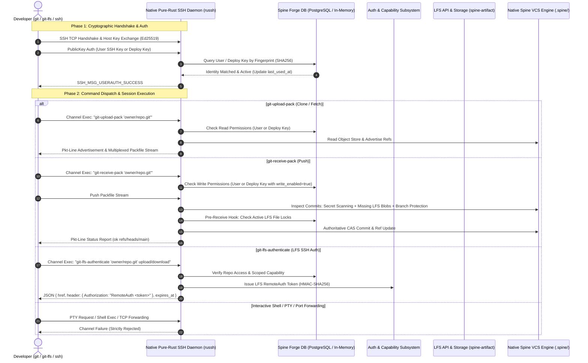

# Spine Forge — Native Git-over-SSH, Key Management, LFS Auth, and Locking Architecture

## 1. System Overview

Spine Forge extends its transport infrastructure with native, pure-Rust Git-over-SSH capability (`russh 0.65` and `ssh-key 0.7`). Official Git clients (`git clone`, `git push`, `git fetch`), SSH agents, and Git LFS clients (`git-lfs` v3.7+) can seamlessly interact with repositories over SSH (`ssh://git@host:port/owner/repo.git` or `git@host:owner/repo.git`) without requiring system `sshd`, external shells, OpenSSH daemons, or `libgit2`.

The SSH server runs alongside the Axum HTTP engine inside `spine-api`, sharing the same content-addressed storage, authorization engine, branch protection, secret scanning rules, Git LFS store, and authoritative write pipeline.



---

## 2. Architectural Pillars

### 2.1 Pure-Rust Native SSH Daemon
- **Zero Host Dependencies:** Completely pure Rust implementation using `russh` and `ssh-key`. No reliance on host `sshd`, POSIX accounts, `/etc/passwd`, or shell binaries.
- **Host Key Management:** Automatically generates and persists an Ed25519 host key at `storage_root/ssh/host_key_ed25519` upon first boot with restrictive filesystem permissions (0600), reloading consistently across restarts.
- **Single Process Integration:** Runs as an asynchronous `tokio` background task within `spine-api`, sharing memory state (`AppState`), database connections, cache, and metrics.

### 2.2 Strict Security Boundary & Restricted Command Dispatch
- **Zero Shell Access:** PTY allocation requests (`pty_request`), interactive shell requests (`shell_request`), X11 forwarding, TCP port forwarding (`tcpip_forward`), and SFTP subsystems are strictly denied.
- **Restricted Command Parser:** Whitelists only three command forms:
  1. `git-upload-pack <path>`
  2. `git-receive-pack <path>`
  3. `git-lfs-authenticate <path> <operation>`
- All commands undergo rigorous argument sanitization: path traversal (`..`), shell metacontrol characters (`;`, `&`, `|`, `` ` ``, `$`), and null bytes are rejected upfront with exit status 1.

### 2.3 Comprehensive SSH Key Management
- **Personal SSH Keys (`UserSshKey`):**
  - Users can upload multiple public keys (Ed25519, ECDSA, RSA) via the REST API (`POST /api/v1/users/me/ssh-keys`).
  - Validation ensures cryptographic correctness, non-weak keys, and unique SHA-256 fingerprints across the platform.
  - Automatically records `last_used_at_nanos` on each successful handshake.
- **Repository Deploy Keys (`DeployKey`):**
  - Project-scoped SSH keys tied directly to specific repositories (`POST /api/v1/repos/:owner/:repo/deploy-keys`).
  - Fine-grained permission model: read-only by default, with an explicit `write_enabled: bool` toggle for CI/CD runners and deployment automations.
  - Revocable instantly without affecting personal user accounts.

### 2.4 Git LFS SSH Authentication Protocol (`git-lfs-authenticate`)
When a developer clones or pushes via an SSH remote (`ssh://git@host/owner/repo.git`), the official `git-lfs` client automatically invokes `ssh git@host git-lfs-authenticate <path> <download|upload>`.
- Spine Forge validates repository access and issues a scoped, short-lived `RemoteAuth` token containing repository ID, user ID, operation, and expiry.
- Spine Forge responds with the standard Git LFS JSON payload:
  ```json
  {
    "href": "https://forge.spine.build/owner/repo.git/info/lfs",
    "header": {
      "Authorization": "RemoteAuth <scoped-hmac-token>"
    },
    "expires_at": "2026-11-04T22:30:00Z"
  }
  ```
- The Git LFS HTTP endpoints (`/info/lfs/objects/batch`, `/info/lfs/objects/:oid`, `/info/lfs/verify`, and `/info/lfs/locks`) seamlessly accept both `Bearer <PAT>`, `Basic <Credentials>`, and `RemoteAuth <Token>`.

### 2.5 Standard Git LFS File Locking API
Implements the full Git LFS v2.0+ File Locking Specification:
1. `POST /:owner/:repo.git/info/lfs/locks`: Acquire an exclusive lock on an uncommitted file path. Returns `409 Conflict` if already locked.
2. `GET /:owner/:repo.git/info/lfs/locks`: List active locks with pagination and path filtering.
3. `POST /:owner/:repo.git/info/lfs/locks/verify`: Verify locks for the current user (categorizing into `ours` and `theirs`).
4. `POST /:owner/:repo.git/info/lfs/locks/:id/unlock`: Release a lock. Normal unlock requires ownership; repository administrators can pass `force: true` to break locks.
5. **Unified Pre-Receive Lock Conflict Fencing:** Both HTTP and SSH `git-receive-pack` handlers inspect modified files against active locks before accepting pushes. If a user attempts to update a file locked by someone else, the push is aborted atomically.

---

## 3. Configuration & Networking

| Configuration Parameter | Environment Variable | Default Value | Description |
|---|---|---|---|
| SSH Port | `SPINE_SSH_PORT` | `2222` | TCP port for the pure-Rust SSH daemon. |
| SSH Bind Host | `SPINE_SSH_HOST` | `0.0.0.0` | Bind IP address for incoming SSH connections. |
| Host Key Directory | `SPINE_STORAGE_ROOT/ssh` | Defaults to storage root | Location for the persistent Ed25519 host key file (`host_key_ed25519`). |
| Public Origin | `SPINE_PUBLIC_ORIGIN` | `http://localhost:8080` | External URL used in `git-lfs-authenticate` responses. |
| Lock Expiry / Idle | N/A | Persistent | Locks persist until explicitly released or force-unlocked by admins. |

---

## 4. Security & Compliance Checklist

- [x] **No NASM or C compiler required for SSH:** Configured `russh` with `ring` backend.
- [x] **Zero shell execution:** No shell processes spawned; all transfers execute entirely inside Rust async memory channels.
- [x] **Strict Pre-Receive Fencing:** Enforces Secret Scanning, Missing LFS Blob checks, Protected Branch rules, and File Locking conflicts on every SSH push.
- [x] **Complete Auditability:** Lock creations, releases, and conflicts recorded in database audit tables.
