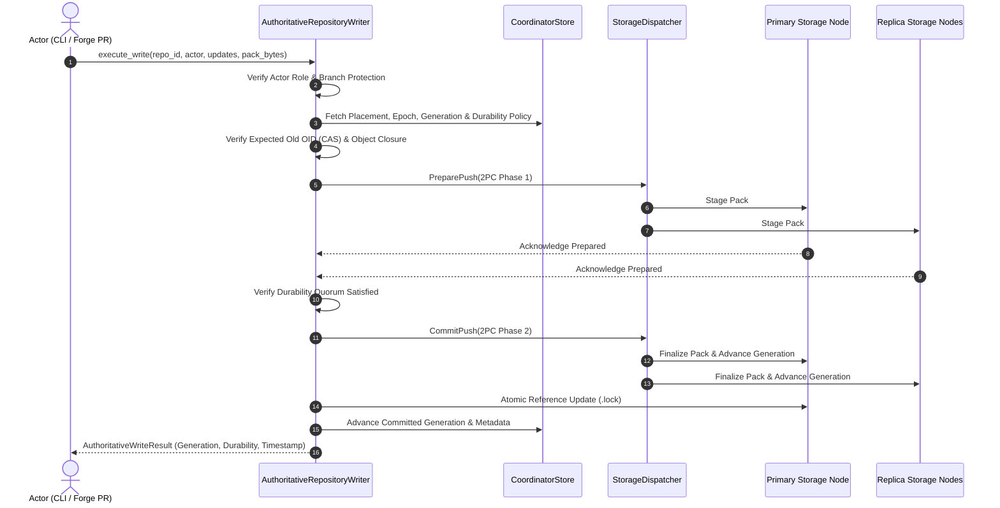

# Distributed Repository Write Path

## 1. Single Authoritative Write Pipeline

All repository-modifying actions in the Spine ecosystem—including native `spine push`, remote SPWP wire updates, and Forge Pull Request merges—execute through **one single authoritative write path**: `AuthoritativeRepositoryWriter`.

No secondary, direct-to-disk or uncoordinated write paths are permitted.

## 2. Invariants Enforced at Write Boundary

1. **Actor Permission**: The actor's capability ticket or authenticated session must have sufficient privilege for the operation.
2. **Branch Protection**: Direct pushes to protected branches require Admin privilege unless PR rules are satisfied.
3. **Fencing and Epochs**: Any request carrying an outdated ownership epoch is immediately rejected.
4. **Compare-And-Swap (CAS)**: Target reference tips must match `expected_old_oid`.
5. **Transitive Object Closure**: New commits and trees are recursively walked to ensure zero missing referenced objects.
6. **Durability Quorum**: Packs must be staged on enough nodes to satisfy the repository's `DurabilityPolicy` before commit decision.
