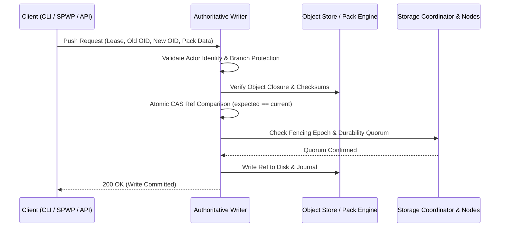

# DISTRIBUTED STORAGE RECOVERY & INTEGRITY SPECIFICATION

**Date:** 2026-11-04  
**Batch Milestone:** Batch 14 — Full-System Integration, Security Hardening, Reliability, Recovery, and Performance  
**Auditor / Engineering Lead:** DeepMind Advanced Agentic Coding Pair Program  
**Workspace:** `d:\Vault\Spine`

---

## 1. AUTHORITATIVE VCS WRITE PIPELINE

Spine enforces a single authoritative write path across all entry points (CLI push, SPWP daemon, Forge web commit, PR merge, and API operations):

### Invariants Enforced
1. **Compare-And-Swap (CAS):** An update to `refs/heads/<name>` fails immediately if the existing tip does not match the client's expected base commit.
2. **Object Closure:** Every commit, tree, and blob referenced by the new ref must be present and verified in the local or replica object stores before the ref is updated.
3. **Fencing Epochs:** A primary storage node must present the current monotonically increasing coordinator epoch token. Stale primaries are fenced off and rejected.

---

## 2. CRASH CONSISTENCY & FAILURE INJECTION

1. **Failure Before Object Transfer:** No objects written, refs remain intact.
2. **Failure During Pack Transfer:** Partial packfile and incoming temporary files are safely cleaned up; `fsck` ignores unreferenced loose temporary objects.
3. **Failure After Pack Persistence but Before Ref Update:** Objects are stored safely; ref still points to previous commit. Next push reuses uploaded objects without data loss.
4. **Failure During Ref Update:** Ref update is performed via atomic rename (`temp_ref` -> `final_ref`). Crash cannot leave a corrupt or half-written ref file.
5. **Anti-Entropy Replica Repair:** If a replica node misses packs during network interruption, the anti-entropy background repair compares pack catalogs, computes missing diffs, and streams repair packs to restore parity.

---

## 3. GARBAGE COLLECTION REACHABILITY & SAFETY

Spine's GC algorithm (`spine-object-store` & `spine-artifact`):
1. **Conservative Reachability Root:** Traces roots from:
   - All branches in `refs/heads/`.
   - All tags in `refs/tags/`.
   - `HEAD` and worktrees in `.spine/worktrees/`.
   - Active stashes in `.spine/stash/`.
   - Active operation journals in `.spine/journal/`.
   - In-flight upload manifests (with a 2-hour grace period).
2. **Grace Period Protection:** Objects newer than the configurable grace window (default 2 weeks, or 1 hour in test configurations) are never deleted, even if unreferenced, protecting concurrent pushes from having their objects garbage collected.
