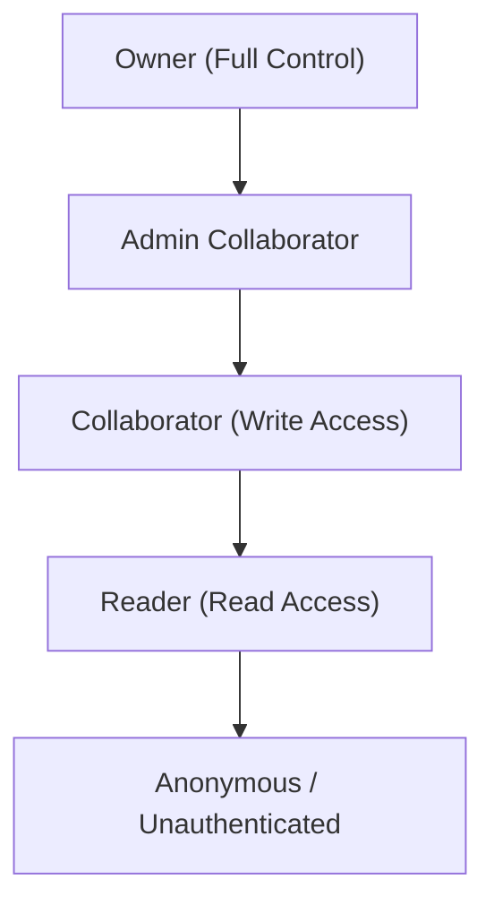

# Spine Forge: Authorization and Permissions Model

## 1. Role-Based Access Control (RBAC) Hierarchy

Repository access in Spine Forge is governed by the `PermissionService` based on explicit role assignments and repository visibility.

### 1.1 Permission Matrix

| Operation | Anonymous (Public) | Anonymous (Private) | Authenticated (Non-Member) | Reader | Collaborator (Write) | Admin / Owner |
|---|---|---|---|---|---|---|
| View Metadata | Allowed | **404 Not Found** | Allowed (Public) / **404** (Private) | Allowed | Allowed | Allowed |
| Browse Tree / Blobs | Allowed | **404 Not Found** | Allowed (Public) / **404** (Private) | Allowed | Allowed | Allowed |
| Inspect Commits / Log | Allowed | **404 Not Found** | Allowed (Public) / **404** (Private) | Allowed | Allowed | Allowed |
| Push / Write Objects | 401 Unauthorized | **404 Not Found** | 403 Forbidden | 403 Forbidden | **Allowed** | **Allowed** |
| Manage Collaborators | 401 Unauthorized | **404 Not Found** | 403 Forbidden | 403 Forbidden | 403 Forbidden | **Allowed** |
| Delete Repository | 401 Unauthorized | **404 Not Found** | 403 Forbidden | 403 Forbidden | 403 Forbidden | **Owner Only** |

## 2. Private Repository Metadata Isolation

A critical vulnerability in many version control web platforms is information leakage through status codes: returning `403 Forbidden` for existing private repositories allows unauthenticated attackers or unauthorized users to enumerate secret project names, internal tooling, or organization repositories.

### Policy Enforcement:
- Unauthenticated requests to private repositories return `404 Not Found`.
- Authenticated requests from users who are not collaborators on a private repository return `404 Not Found`.
- Existence, branch names, commit hashes, and description are strictly hidden until authorization is confirmed.
