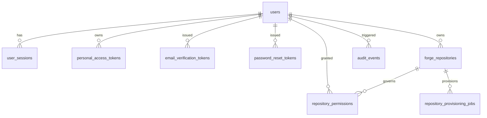

# Spine Forge: Relational Database Architecture

## 1. Schema Design (PostgreSQL DDL)

The Spine Forge relational catalog maintains account identities, cryptographic token hashes, repository metadata, permissions, provisioning jobs, and audit trails across 9 core tables:

### 1.1 Tables Overview

1. **`users`**: Core account identities, normalized usernames, email addresses, display names, and Argon2id password hashes.
2. **`user_sessions`**: Active browser sessions, IP addresses, user agents, expiration timestamps, and BLAKE3 session token hashes.
3. **`email_verification_tokens`**: One-time tokens for account email verification.
4. **`password_reset_tokens`**: Time-limited one-time tokens for self-service password recovery.
5. **`personal_access_tokens`**: Scoped developer API tokens for CLI and CI/CD operations with last-used tracking.
6. **`forge_repositories`**: Logical repository entities, visibility flags, default branch, durability policies, and provisioning statuses.
7. **`repository_permissions`**: Explicit role assignments (`READER`, `COLLABORATOR`, `OWNER`) binding users to repositories.
8. **`repository_provisioning_jobs`**: Outbox pattern job queue for asynchronous, resilient repository initialization and cluster placement.
9. **`audit_events`**: Immutable event log tracking authentication events, permission alterations, and repository provisioning/deletions.

## 2. Dual Database Abstraction

To support both enterprise production deployments and hermetic, zero-dependency testing, all repository operations interact through the `Database` trait.

### 2.1 `PgDatabase`
- Production PostgreSQL engine powered by `sqlx`.
- Parameterized SQL queries preventing injection vulnerabilities.
- Automatic connection pooling and timeout handling.

### 2.2 `InMemoryDatabase`
- Thread-safe, fully concurrent in-memory store using `RwLock<HashMap<...>>`.
- Normalized indexes for primary keys, usernames, emails, and token hashes.
- Enables lightning-fast, reproducible integration testing without requiring local Docker or PostgreSQL daemons.
