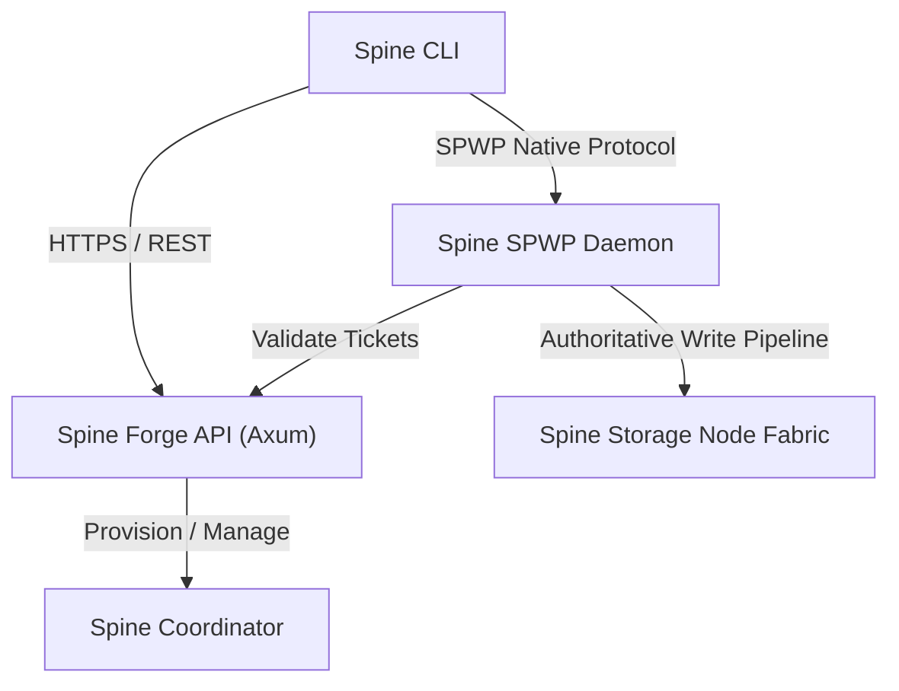

# Spine Forge Native Repository Hosting

## 1. Hosting Architecture

Spine Forge is a complete developer collaboration and code-hosting platform built from the ground up without third-party version-control wrappers.

## 2. Capability Ticket Integration

Forge bridges web identity (sessions and Personal Access Tokens) to high-speed SPWP transport using signed, short-lived **Capability Tickets**:
1. When a client performs a remote operation (`clone`, `fetch`, `push`, `pull`), the CLI requests a capability ticket from:
   `POST /api/v1/repos/:owner/:repo/capability`
2. Forge verifies the user's role and permissions against the repository:
   - For private repositories, unauthorized requests return `404 Not Found` to eliminate existence discovery.
   - For public repositories, anonymous readers are granted `Role::Reader`.
   - Authorized contributors and repository owners receive `Role::Contributor` or `Role::Admin`.
3. Forge generates a cryptographically signed ticket with BLAKE3 keyed hashing:
   - Contains: `user_id`, `username`, `repo_id`, `native_repo_id`, `role`, `issued_at`, `expires_at`, `nonce`.
   - Format: `<hex_payload>.<signature_hex>`.
4. The SPWP daemon decodes and validates the ticket signature and timestamp against the cluster auth secret, bounding the session strictly to the target repository.

## 3. Storage Hierarchy

- **Logical Layer**: Forge repositories identified by `owner_user_id` or `owner_org_id` with normalized names.
- **Physical Layer**: Content-addressed `.spine` directories and storage nodes hosting loose Zstandard objects and `.spk` binary packfiles indexed by `.spidx` tables.
- **Placement Layer**: Coordinator tracks primary and replica nodes with epoch assignments.
