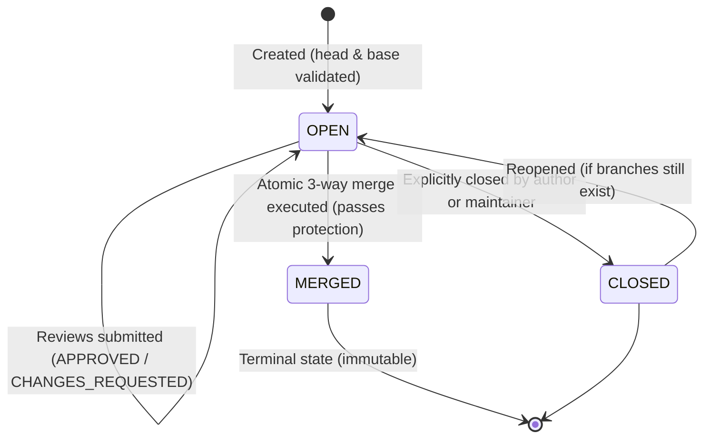

# Spine Forge: Pull Request Architecture and State Transitions

## 1. Overview

Pull Requests (PRs) in Spine Forge represent proposed branch integrations within a repository. Unlike simple diff displays, PRs represent a fully managed state machine tracking branch divergence, automated mergeability evaluation, code review approvals, branch protection adherence, and atomic branch ref updates.

---

## 2. Relational Schema

Defined in `migrations/20261103000002_forge_collaboration.sql`:

```sql
CREATE TABLE IF NOT EXISTS pull_requests (
    id VARCHAR(64) PRIMARY KEY,
    repo_id VARCHAR(64) NOT NULL REFERENCES forge_repositories(id) ON DELETE CASCADE,
    pr_number INT NOT NULL,
    author_user_id VARCHAR(64) NOT NULL REFERENCES users(id) ON DELETE CASCADE,
    title VARCHAR(256) NOT NULL,
    body TEXT NOT NULL DEFAULT '',
    base_branch VARCHAR(128) NOT NULL, -- Target branch (e.g. main)
    head_branch VARCHAR(128) NOT NULL, -- Source branch (e.g. feature-x)
    base_commit_id VARCHAR(64) NOT NULL,
    head_commit_id VARCHAR(64) NOT NULL,
    state VARCHAR(32) NOT NULL DEFAULT 'OPEN', -- 'OPEN', 'CLOSED', 'MERGED'
    merged_at_nanos BIGINT,
    merged_by_user_id VARCHAR(64) REFERENCES users(id) ON DELETE SET NULL,
    merge_commit_id VARCHAR(64),
    closed_at_nanos BIGINT,
    closed_by_user_id VARCHAR(64) REFERENCES users(id) ON DELETE SET NULL,
    created_at_nanos BIGINT NOT NULL,
    updated_at_nanos BIGINT NOT NULL,
    UNIQUE (repo_id, pr_number)
);

CREATE TABLE IF NOT EXISTS pull_request_reviewers (
    pr_id VARCHAR(64) NOT NULL REFERENCES pull_requests(id) ON DELETE CASCADE,
    user_id VARCHAR(64) NOT NULL REFERENCES users(id) ON DELETE CASCADE,
    requested_at_nanos BIGINT NOT NULL,
    PRIMARY KEY (pr_id, user_id)
);
```

---

## 3. Pull Request Lifecycle State Machine



### Invariants:
1. **Target Immutability:** Once a pull request transitions to `MERGED`, its state is strictly immutable. It cannot be reopened, closed, or re-merged.
2. **Branch Existence:** Opening a PR requires both `base_branch` and `head_branch` to resolve to valid commits in `.spine/refs/heads/`.
3. **Branch Divergence:** The head and base branches cannot refer to the exact same commit; opening a PR with zero differences is rejected with `400 Bad Request`.
4. **Auto-Update:** Querying a PR's diff or mergeability evaluates the latest tips of `base_branch` and `head_branch`.

---

## 4. API Endpoints

- `GET /api/v1/repos/:owner/:repo/pulls`: List pull requests (filtered by `state=OPEN|CLOSED|MERGED`).
- `POST /api/v1/repos/:owner/:repo/pulls`: Propose a new pull request.
- `GET /api/v1/repos/:owner/:repo/pulls/:number`: Retrieve pull request metadata.
- `PATCH /api/v1/repos/:owner/:repo/pulls/:number`: Update title, body, or state (`CLOSED` / `OPEN`).
- `GET /api/v1/repos/:owner/:repo/pulls/:number/diff`: Compute three-dot unified diff and file additions/deletions.
- `GET /api/v1/repos/:owner/:repo/pulls/:number/mergeability`: Test fast-forward or three-way tree merge cleanly.
- `POST /api/v1/repos/:owner/:repo/pulls/:number/merge`: Execute atomic merge and update base ref.
