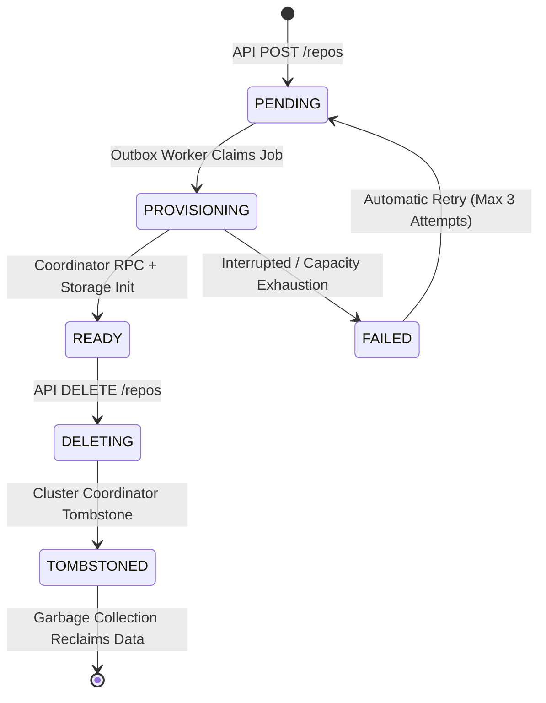

# Spine Forge: Repository Lifecycle and Provisioning Pipeline

## 1. Lifecycle State Machine

Repository lifecycle in Spine Forge is asynchronous, resilient to crashes, and strictly tracked via the `ProvisioningStatus` state machine:

### 1.1 State Definitions
- **`PENDING`**: Repository record inserted in database; outbox job queued. Not yet accessible for pushes.
- **`PROVISIONING`**: Background `ProvisioningWorker` has claimed the job and is negotiating storage node placement with `spine-coordinator`.
- **`READY`**: Replicas assigned, directory hierarchy (`.spine/objects/pack`, `refs/heads`, `HEAD`, `config`, `ownership_epoch`) initialized, ready for read/write.
- **`FAILED`**: Provisioning encountered an error. Scheduled for exponential backoff retry.
- **`DELETING`**: Marked for deletion by owner; read and write operations are blocked.
- **`TOMBSTONED`**: Coordinator registered tombstone record; pending asynchronous physical deletion by distributed GC.

## 2. Asynchronous Outbox Pattern

To prevent long-running storage filesystem operations or RPC timeouts from blocking client HTTP request threads, creation follows the transactional outbox pattern:

1. **Client Request**: `POST /api/v1/repos` validates repository name, verifies user identity, and writes both `forge_repositories` and `repository_provisioning_jobs` atomically.
2. **Immediate Return**: Client receives HTTP 201 Created with status `PENDING`.
3. **Worker Processing**: The `ProvisioningWorker` background loop queries `get_next_pending_job()`:
   - Sets status to `PROVISIONING`.
   - Sends `AllocateRepository` RPC to `spine-coordinator`.
   - Initializes native `.spine` repository structure on assigned storage nodes.
   - Sets status to `READY`.
4. **Idempotency**: Every provisioning job carries an `idempotency_key = "prov_<repo_id>"`. If a worker crashes midway, subsequent execution safely re-checks existing placement without duplicate allocations.
