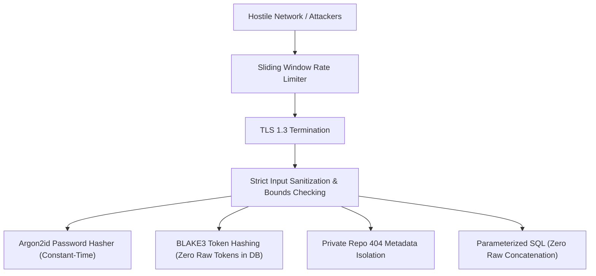

# Spine Forge: Security and Threat Model

## 1. Security Architecture

Spine Forge is designed with a defense-in-depth posture against external attackers, hostile networks, and insider threats.

## 2. Threat Analysis and Mitigations

### 2.1 Credential Compromise & Database Breach
- **Threat**: Attacker steals a database backup containing password hashes.
- **Mitigation**: Passwords are hashed with Argon2id using unique 16-byte random salts. GPU and ASIC cracking costs are astronomically high.

### 2.2 Token Theft from Database
- **Threat**: Attacker accesses the `user_sessions` or `personal_access_tokens` table.
- **Mitigation**: Raw session tokens (`sp_sess_...`) and PATs (`sp_pat_...`) are **never stored** in the database. Only their 256-bit BLAKE3 hashes are persisted. Stolen hashes cannot be used to authenticate API requests.

### 2.3 Private Repository Enumeration & Timing Attacks
- **Threat**: Attacker probes endpoint URLs like `/api/v1/repos/target-corp/secret-project` to detect confidential projects or acquisitions.
- **Mitigation**:
  - The API returns `404 Not Found` for private repositories when the caller lacks access, completely indistinguishable from non-existent repositories.
  - Constant-time password and token comparisons eliminate timing or side-channel leakages.

### 2.4 Directory Traversal & Storage Injection
- **Threat**: Attacker specifies malicious repository names or file paths like `../../etc/passwd` or `project..dots`.
- **Mitigation**:
  - Repository name validator rejects `..`, leading dashes, dots, and non-alphanumeric characters.
  - Path traversal validator in `NativeVcsService` strips leading/trailing slashes and rejects any segment equal to `..` or `.`.

### 2.5 Denial of Service & Brute-Force Attacks
- **Threat**: Attacker hammers authentication endpoints with credential dictionaries.
- **Mitigation**:
  - `RateLimiter` limits attempts per IP with sliding window tracking.
  - Axum body extractors enforce maximum payload byte limits, preventing memory exhaustion.
