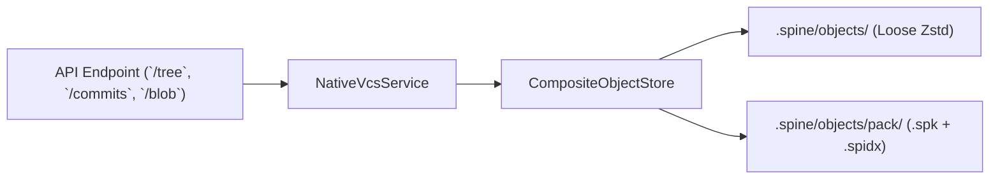

# Spine Forge: Native Storage Integration

## 1. Native VCS Inspection

Spine Forge does not invoke any Git binaries, does not link against `libgit2`, and does not run shell subprocesses to display repository code. All repository browsing is performed natively by the `NativeVcsService` using Spine's own crates:

- **`spine-format`**: Binary deserializers for commits (`deserialize_commit`), trees (`deserialize_tree`), and tags.
- **`spine-object-store`**: `CompositeObjectStore` reading loose Zstandard objects and `.spk` native packfiles via index fanout.
- **`spine-core`**: Object identifiers, file modes, and type definitions.

## 2. Browsing Pipeline

### 2.1 Branch and Tag Discovery
- Branches are enumerated by listing `.spine/refs/heads/`. The default branch is determined from `.spine/HEAD` (`ref: refs/heads/main`).
- Tags are enumerated by reading `.spine/refs/tags/`.

### 2.2 Commit Graph Traversal
- Given a branch name or commit hash, `NativeVcsService::resolve_ref` reads the commit SHA.
- `get_commits` loads the `Commit` object, parses author, committer, timestamp, and message, and traverses parent hashes backwards up to the requested limit.

### 2.3 Tree Traversal & Path Resolution
- `get_tree` resolves the root tree object ID from the commit.
- For subpaths (e.g., `src/core`), it traverses directory trees iteratively, validating path segments to prevent directory traversal (`..` rejected).
- Returns tree entries classified as directories or files with their modes and object IDs.

### 2.4 Blob Retrieval
- `get_blob` loads the requested file's blob object from `CompositeObjectStore`.
- Checks for null bytes or UTF-8 validity to flag binary files (`is_binary: true`).
- Returns raw text content for syntax rendering in the web interface.
