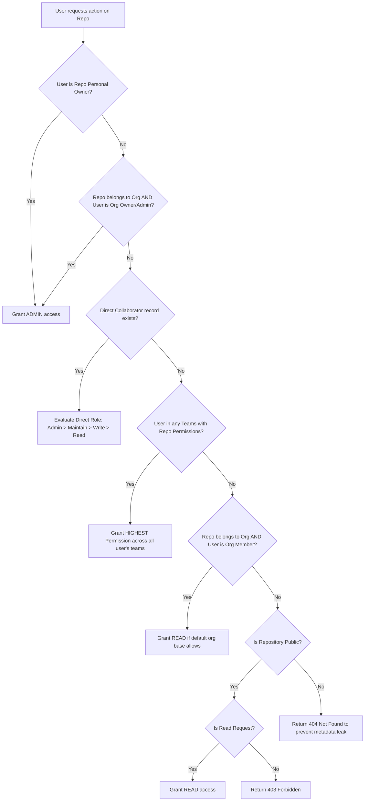

# Spine Forge: Teams and Unified RBAC Authorization Matrix

## 1. Overview

Within an Organization, user access is scaled and managed through **Teams**. Teams allow grouping members and granting granular repository access permissions (`READ`, `WRITE`, `MAINTAIN`, `ADMIN`) across multiple repositories simultaneously.

---

## 2. Relational Schema

Defined in `migrations/20261103000002_forge_collaboration.sql`:

```sql
CREATE TABLE IF NOT EXISTS teams (
    id VARCHAR(64) PRIMARY KEY,
    org_id VARCHAR(64) NOT NULL REFERENCES organizations(id) ON DELETE CASCADE,
    name VARCHAR(64) NOT NULL,
    normalized_slug VARCHAR(64) NOT NULL,
    description TEXT NOT NULL DEFAULT '',
    created_at_nanos BIGINT NOT NULL,
    UNIQUE (org_id, normalized_slug)
);

CREATE TABLE IF NOT EXISTS team_memberships (
    id VARCHAR(64) PRIMARY KEY,
    team_id VARCHAR(64) NOT NULL REFERENCES teams(id) ON DELETE CASCADE,
    user_id VARCHAR(64) NOT NULL REFERENCES users(id) ON DELETE CASCADE,
    created_at_nanos BIGINT NOT NULL,
    UNIQUE (team_id, user_id)
);

CREATE TABLE IF NOT EXISTS team_repository_permissions (
    id VARCHAR(64) PRIMARY KEY,
    team_id VARCHAR(64) NOT NULL REFERENCES teams(id) ON DELETE CASCADE,
    repo_id VARCHAR(64) NOT NULL REFERENCES forge_repositories(id) ON DELETE CASCADE,
    permission VARCHAR(32) NOT NULL, -- 'READ', 'WRITE', 'MAINTAIN', 'ADMIN'
    created_at_nanos BIGINT NOT NULL,
    UNIQUE (team_id, repo_id)
);
```

---

## 3. The 6-Level Permission Resolution Engine

Permission evaluation is implemented in `github-alternative/backend/apps/spine-api/src/permissions/service.rs`. Access is resolved through a deterministic hierarchy of checks:



### Permission Levels

1. **`ADMIN`:**
   - Modify repository settings, transfer ownership, delete repository.
   - Configure branch protection rules.
   - Add/remove collaborators and assign team permissions.
   - Bypass branch protection if rule permits.
   - All WRITE and READ capabilities.

2. **`MAINTAIN`:**
   - Manage issues (assign, edit, label, close/reopen).
   - Manage milestones and project labels.
   - Triage pull requests and manage review requests.
   - All WRITE and READ capabilities.

3. **`WRITE`:**
   - Push to unprotected branches.
   - Propose, update, and close pull requests.
   - Submit formal code reviews (Approve, Request Changes).
   - Merge approved pull requests matching branch protection criteria.
   - Comment on issues, PRs, and inline code diffs.
   - All READ capabilities.

4. **`READ`:**
   - Browse repository commit history, trees, blobs, branches, and tags.
   - View issues, pull requests, unified diffs, and comments.
   - Open new issues and PRs (if allowed by repo policy).

---

## 4. Metadata Leakage Prevention (404 Semantics)

When a user who does not have access attempts to query a private repository or private organization, the API **never** returns `403 Forbidden`. Returning `403` informs an attacker that a private resource exists with that name. Instead, the permissions service returns `SpineApiError::NotFound("Repository not found")`, preserving strict multi-tenant privacy.
