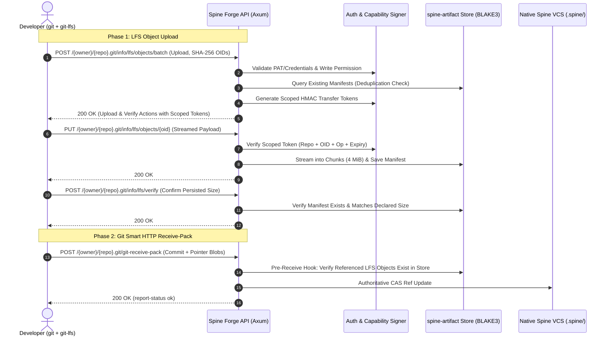

# Spine Forge — Native Git LFS HTTP Architecture

## 1. System Overview

Spine Forge provides native, standard Git LFS (Large File Storage) HTTP transport compatibility, enabling official Git LFS clients (`git-lfs` v3.7+) to push, fetch, and pull large binary assets directly against Spine Forge repositories without external wrappers or proxy daemons.

The implementation builds upon Spine's native distributed content-addressed storage engine (`spine-artifact`) and authoritative repository write pipeline, maintaining strict repository isolation, quota enforcement, and pre-receive integrity verification.

---

## 2. Core Architectural Principles

1. **Zero External Runtime Dependencies:**
   - Pure Rust implementation using `axum`, `tokio`, `sha2`, `spine-artifact`, and `spine-migration`.
   - Neither Git, Git LFS, nor `libgit2` are invoked by the running backend server.
2. **Standard Git LFS Protocol Compliance:**
   - Implements the official Git LFS Batch API v1 and Basic Transfer Adapter.
   - Emits standard `application/vnd.git-lfs+json` media types.
3. **Internal Storage Integration (`spine-artifact`):**
   - High-performance, deduplicated chunk storage using FastCDC/stream chunking and BLAKE3 verification.
   - Bidirectional identity mapping between external Git LFS SHA-256 OIDs and internal BLAKE3 manifests.
4. **Authoritative Consistency & Pre-Receive Fencing:**
   - `git-receive-pack` parses incoming Git commits and inspects all new blobs.
   - If an LFS pointer is introduced without its backing binary object having been uploaded and verified in `spine-artifact`, the push is rejected immediately on the server side with a descriptive client-visible error.
5. **Short-Lived Scoped Capabilities:**
   - Upload and download URLs are protected by HMAC-SHA256 scoped capability tokens bound to repository ID, object SHA-256 OID, operation, max allowed size, and TTL.
