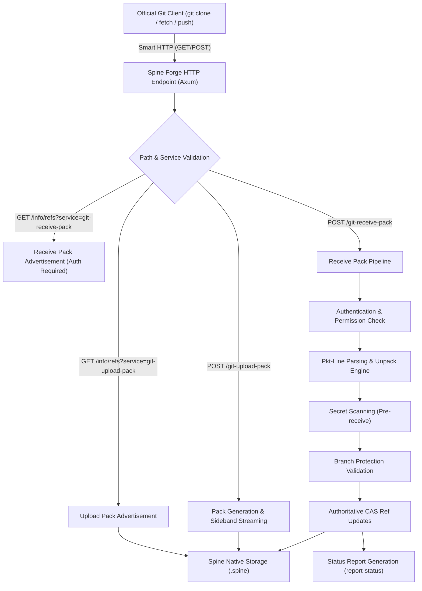

# Spine Forge Git Smart HTTP Architecture

## Overview

Spine Forge provides native, bidirectional interoperability with official Git clients using the standard Git Smart HTTP protocol (v1). All Git transport operations—including reference discovery, thin pack negotiation, packfile streaming, and ref updates—are executed by a pure Rust protocol engine without invoking external Git or `libgit2` runtime executables.

## Architectural Highlights

1. **Pure Rust Runtime**:
   - Zero external process spawning.
   - Zero reliance on system `git` or `libgit2` dynamic libraries in production.
   - Built on Tokio, Axum, and Spine's native object store format.

2. **Bidirectional Format Translation**:
   - Packfiles pushed by Git clients are decoded and ingested into Spine's content-addressed object store (`spine-object-store`).
   - Git commits, trees, blobs, and annotated tags are converted to Spine native objects while preserving bit-for-bit Git object hashes (`GitOid`).
   - Raw Git object caching guarantees round-trip SHA-1 preservation across independent Git client clones and pushes.

3. **Multi-Tenant Identity & Access**:
   - Standard URLs: `/{owner}/{repo}.git` and `/{owner}/{repo}`.
   - Supports user accounts and organization-owned repositories.
   - Public repositories allow anonymous discovery and clone/fetch.
   - Private repositories and all push operations require HTTP Basic authentication using Forge user credentials or Personal Access Tokens (`sp_pat_...`).

4. **Authoritative Consistency & Safety**:
   - Atomic Compare-And-Swap (CAS) reference updates prevent concurrent push races and stale reference overwrites.
   - Integrated pre-receive hook enforcement:
     - Branch protection rules (pull request requirements, fast-forward enforcement, administrator approvals).
     - Automated credential and secret scanning on newly received blobs.
