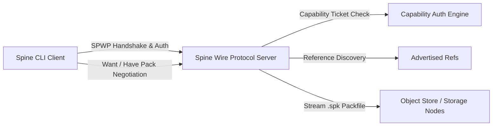

# Native Remote Transport Specification

## 1. Overview and Architecture

Spine Remote Transport operates over the Spine Wire Protocol (SPWP v1), a binary, framed, multiplexed protocol designed specifically for content-addressed version control operations without reliance on Git Smart HTTP, git-upload-pack, or libgit2.

Remote transport handles two primary URI schemes:
- `spine://<host>[:<port>]/<owner>/<repo>`: Native SPWP transport over TCP (port default `9090`).
- `spines://<host>[:<port>]/<owner>/<repo>`: TLS 1.3 secured SPWP transport with ALPN negotiation (`spwp/1`).



## 2. Frame Structure and Multiplexing

All SPWP frames follow a strict 12-byte header:

```
+---------------+---------------+---------------+-------------------------------+
| Magic (2B)    | Version (1B)  | MsgType (1B)  | Stream ID (4B)                |
| 0x53 0x50     | 0x01          | 0x01..0x09    | Big-Endian u32                |
+---------------+---------------+---------------+-------------------------------+
| Payload Length (4B, Big-Endian u32, max 16 MiB)                                |
+-------------------------------------------------------------------------------+
| Payload Bytes (0..16,777,216 bytes) ...                                       |
+-------------------------------------------------------------------------------+
```

### Message Types:
- `0x01` (`HELLO`): Protocol version and capability exchange.
- `0x02` (`AUTH`): Capability ticket or Ed25519 challenge-response handshake.
- `0x03` (`REPO_OPEN`): Request target repository namespace.
- `0x04` (`REF_DISCOVERY`): Advertisement of branch and tag references with OIDs.
- `0x05` (`NEGOTIATION`): `want` and `have` object sets for pack calculation.
- `0x06` (`PACK_DATA`): Streamed compressed object pack chunks (`.spk`).
- `0x07` (`REF_UPDATE`): Atomic proposal of old OID -> new OID ref updates.
- `0x08` (`STATUS`): Operation confirmation, durability report, or error payload.
- `0x09` (`PING` / `PONG`): Session keepalive and latency measurement.

## 3. Remote Operations: Clone, Fetch, Push, Pull

### Clone:
1. Connects to `spine://` endpoint.
2. Exchanges `HELLO` and authenticates using signed `CapabilityTicket` (`ticket:<hex>.<sig>`).
3. Sends `REPO_OPEN` for target `<owner>/<repo>`.
4. Receives advertised references.
5. Sends empty `have` set with `want` pointing to default branch tip.
6. Downloads binary `.spk` packfile and indices locally.
7. Checks out working tree.

### Push:
1. Performs reference negotiation: sends updated branch tip OID.
2. Packages missing objects between remote tip and local branch into `.spk` packfile.
3. Streams `.spk` and checksums to remote daemon.
4. Sends `REF_UPDATE` proposals specifying `expected_old_oid` (CAS) and `new_oid`.
5. Remote daemon verifies actor authorization, branch protection, object closure, and commits through the Authoritative Distributed Write Pipeline.
