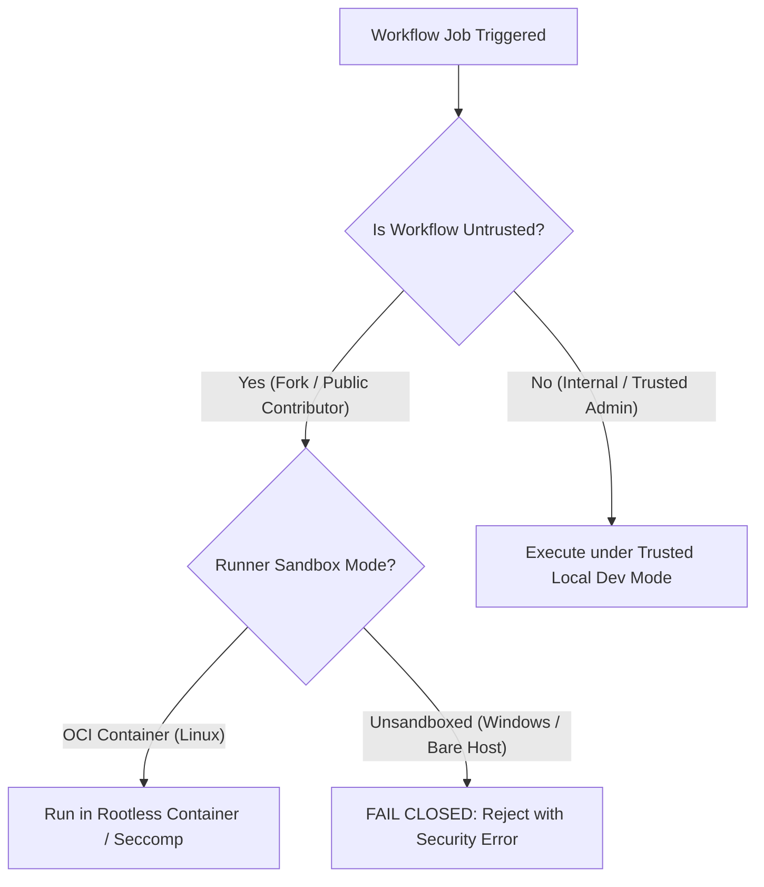

# RUNNER THREAT MODEL & EXECUTION BOUNDARIES

**Date:** 2026-11-04  
**Batch Milestone:** Batch 14 — Full-System Integration, Security Hardening, Reliability, Recovery, and Performance  
**Auditor / Engineering Lead:** DeepMind Advanced Agentic Coding Pair Program  
**Workspace:** `d:\Vault\Spine`

---

## 1. THREAT ACTORS AND ATTACK VECTORS

CI/CD runners execute untrusted code submitted by developers, contributors, and external fork PR authors. The threat model encompasses:

1. **Malicious Repository Workflows:** Workflows crafted to execute hostile commands (`rm -rf`, `curl 169.254.169.254`, memory exhaustion).
2. **Untrusted Fork Pull Requests:** External PRs attempting to exfiltrate organizational secrets or repository PATs.
3. **Lateral Movement to Host Infrastructure:** Attempting to reach PostgreSQL, Spine Coordinator, Storage Nodes, or internal networks from workflow scripts.
4. **Denial of Service:** Fork bombs, unbounded CPU loops, and disk exhaustion.
5. **Runner Lease / Fencing Hijacking:** Stale runners attempting to overwrite completed job outputs or inject fake statuses.

---

## 2. SECURITY ARCHITECTURE & EXECUTION MODES

Spine adopts a **fail-closed** multi-tiered execution model:

### Execution Modes
1. **`RunnerSandboxMode::SandboxedOci` (Linux):**
   - Uses rootless OCI containers (runc / crun).
   - Read-only root filesystem with isolated tmpfs mount for workspace.
   - Dropped capabilities (`CAP_NET_RAW`, `CAP_SYS_ADMIN`).
   - Seccomp filters blocking dangerous syscalls.
   - Network namespace restricted or disabled.
2. **`RunnerSandboxMode::TrustedLocalDevelopment` (Dev Workstations):**
   - Explicitly enabled for developer workstation testing only.
   - Sanitized environment variables, bounded timeouts, and process-tree termination (`taskkill /T /F`).
3. **`RunnerSandboxMode::Unsandboxed`:**
   - Default when running on bare host without container runtime.
   - **Fails closed for all untrusted workflows.** Untrusted workflows are rejected with exit code 1 and error:  
     `"SECURITY ERROR: Untrusted workflow execution requires a verified sandbox (e.g. OCI container isolation). Unsandboxed execution of untrusted workflows is disabled on this platform/backend to prevent host compromise."`

---

## 3. RUNNER CREDENTIAL ISOLATION

1. **Database & Infrastructure Secrets:** Runners NEVER receive PostgreSQL credentials, Spine Coordinator admin keys, or TLS private keys.
2. **Forked Pull Request Secrets:** In `RunnerService::acquire_job`, if `trigger_event == "pull_request_fork"` or `"fork"`, secrets are withheld by default (`vec![]`).
3. **Short-Lived Capability Tokens:** Runners communicate via HMAC-signed, time-bounded capability tokens (`CapabilityTicket`) tied to specific `job_id`, `runner_id`, and `fencing_token`. Expired tokens are rejected.
4. **Secret Masking:** All workflow logs emitted to `stdout` or `stderr` are scanned and replaced with `***` before database ingestion.
