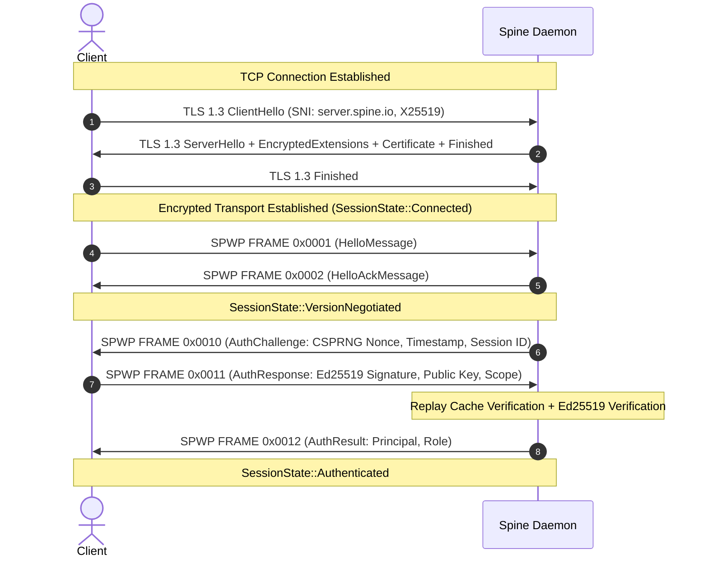

# Spine Wire Protocol (SPWP) — TLS 1.3 Transport Security Specification

## 1. Executive Architecture

Spine Wire Protocol (`SPWP`) employs **Transport Layer Security (TLS) 1.3** (`RFC 8446`) as its primary transport encryption and peer confidentiality layer. Built entirely in Rust upon `rustls 0.23` and `tokio-rustls 0.26` backed by `ring 0.17`, SPWP enforces zero-trust confidentiality, forward secrecy, and tampering resistance over hostile or untrusted IP networks.

```
+-------------------------------------------------------------+
|                SPWP Application Layer (Messages)            |
+-------------------------------------------------------------+
|                SPWP Framing Layer (20-byte Header)          |
+-------------------------------------------------------------+
|               Session State Machine (Explicit States)       |
+-------------------------------------------------------------+
|               TLS 1.3 Record Layer (rustls / ring)          |
+-------------------------------------------------------------+
|               TCP Transport (tokio::net::TcpStream)         |
+-------------------------------------------------------------+
```

---

## 2. Cryptographic Cipher Suites and Protocols

SPWP transport security exclusively negotiates **TLS 1.3** and explicitly prohibits deprecated protocols (SSLv2, SSLv3, TLS 1.0, TLS 1.1). TLS 1.2 is permitted exclusively as an authenticated fallback for legacy systems when configured with AEAD cipher suites.

### Permitted TLS 1.3 Cipher Suites
1. `TLS_AES_256_GCM_SHA384` (Default for high-security deployments)
2. `TLS_CHACHA20_POLY1305_SHA256` (Optimized for environments without hardware AES-NI)
3. `TLS_AES_128_GCM_SHA256`

### Key Exchange and Curves
- `X25519` (`Curve25519` ECDHE key exchange)
- `secp256r1` (NIST P-256 fallback)

Static RSA key exchange, CBC-mode ciphers, SHA-1, and insecure renegotiation are strictly disabled at compile time.

---

## 3. Certificate Validation and Public Key Infrastructure (PKI)

### 3.1 Server Identity Verification
Every client connecting via the `spine://` scheme verifies:
1. **Certificate Chain Integrity**: Valid signatures from trust anchors in `rustls::RootCertStore`.
2. **Server Name Indication (SNI)**: The presented certificate must match the host extracted from the `SpineUrl` (`rustls_pki_types::ServerName`).
3. **Temporal Validity**: Current timestamp must strictly fall within `notBefore` and `notAfter`.
4. **Revocation & Key Usage**: Standard digital signature and server authentication extensions (`id-kp-serverAuth`).

### 3.2 Ephemeral Self-Signed Certificates (`rcgen`)
For local developer testing and internal enterprise mesh networks, the daemon can generate standards-compliant X.509 v3 certificates on demand using `rcgen 0.13` with `ring` key generation. Subject Alternative Names (SANs) default to `localhost`, `127.0.0.1`, and `::1`.

---

## 4. The Loopback Plaintext Security Boundary

To protect against inadvertent plaintext data exposure, SPWP enforces a strict security boundary:

| Scheme | Protocol | Permitted Network Interfaces | Enforcement Mechanism |
|---|---|---|---|
| `spine://` | TLS 1.3 | All (Loopback, LAN, WAN, Internet) | Mandatory certificate check |
| `spinelocal://` | Plaintext TCP | **Loopback Only** (`127.0.0.0/8`, `::1`) | Kernel peer IP inspection |

### Daemon Peer Check Rule
```rust
if tls_acceptor.is_none() && !is_loopback_addr(&peer_addr) {
    eprintln!("[SECURITY VIOLATION] Dropping unencrypted connection from non-loopback peer: {}", peer_addr);
    continue; // Closes socket immediately without processing any frames
}
```

Any attempt to connect using `spinelocal://` or `--insecure-plain` across non-loopback interfaces is rejected client-side with `ClientError::PlaintextForbiddenOutsideLoopback` and server-side with immediate TCP reset.

---

## 5. Handshake and State Transition Sequence



---

## 6. Denial-of-Service and Resource Hardening

1. **Connection Bounding**: Daemon throttles concurrent connections using `tokio::sync::Semaphore` (default: 256 concurrent streams).
2. **Read Timeouts**: Frame reads enforce `tokio::time::timeout(Duration::from_secs(30))` preventing slow-loris attacks.
3. **Payload Bounds**: 20-byte header payload length is capped at `16 MB` (`MAX_PAYLOAD_SIZE`).
